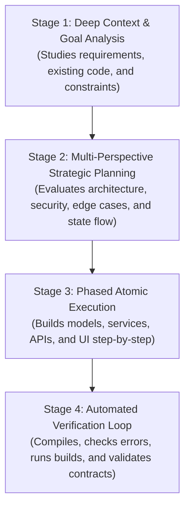

# Boost Action Explained in Simple Words

---

## 🧠 What is "Boost" in Simple Terms?

Imagine you are building a house:
* **Normal Mode (Quick Answer):** A single worker immediately grabs a hammer and starts nailing boards together. It is very fast, but they might forget to check if the foundation can hold a second floor.
* **Boost Mode / Boost Action:** A team arrives first — a **Senior Architect**, a **Structural Engineer**, and a **Safety Inspector**. 
  - They study the ground.
  - They create a detailed blueprint.
  - They check for earthquake risks and water lines.
  - Then they build the house phase by phase and test every pillar before moving to the roof.

In AI-assisted software development, **Boost** is an advanced operational mode that switches the AI assistant from *simple text completion* to **deep architectural reasoning, strategic multi-step planning, and rigorous verification**.

---

## 🎯 Main Uses of Boost Action

Use the **Boost Action** whenever the task is too important or too complex for quick guesswork:

| Use Case | Why Boost is Needed | Real-World Example |
|---|---|---|
| **1. Starting a New Full-Stack Project** | Prevents architectural mistakes that become painful to rewrite later. | Designing **FurniNest** (.NET + Angular) with clean layers, JWT security, and SQLite persistence. |
| **2. High-Concurrency & Real-Time Logic** | Race conditions and deadlocks cannot be solved with simple trial-and-error. | Designing **PulseFlow** (SignalR hubs, background workers, and thread-safe cancellation tokens). |
| **3. Complex Business Workflows** | Ensures business rules, edge cases, and state machines are respected. | Handling shopping carts, stock deduction, payment authorization, and order status transitions. |
| **4. Deep Debugging & Root Cause Analysis** | Finds *why* a bug happened at the architectural root instead of just applying a quick temporary patch. | Investigating memory leaks, CORS issues, or broken database migrations. |
| **5. Security & Threat Hardening** | Protects sensitive user data and authentication boundaries. | Designing role-based access control (Admin vs Customer) and preventing unauthorized API access. |

---

## ⚙️ How Boost Works During Implementation

When a **Boost Action** is triggered, it follows a 4-stage execution cycle:



### Stage 1: Deep Context & Goal Analysis
* Analyzes the workspace, existing SDK versions (.NET 10, Angular 21), installed packages, and folder structure.
* Clarifies the real business goal (e.g., selling furniture online with Admin & Customer roles).

### Stage 2: Strategic Planning (Multi-Perspective Thinking)
* Looks at the project from 3 different lenses:
  1. **The Software Architect:** Clean separation of concerns (Controllers ➔ Services ➔ DbContext).
  2. **The Security Engineer:** Password hashing (BCrypt), JWT claims, token expiry, CORS policies.
  3. **The End-User (UX):** Responsive screens, live cart progress, clear order tracking steppers.

### Stage 3: Phased Atomic Execution
* Instead of dumping 500 lines of messy mixed code into one file, it creates clean, self-contained files:
  - Models (`User.cs`, `Order.cs`, `Product.cs`)
  - Contracts & DTOs
  - API Controllers
  - Reactive Angular components and Signal stores

### Stage 4: Continuous Verification
* Automatically tests every piece as it is created:
  - Runs `dotnet build` to ensure 0 C# compiler errors.
  - Runs `npm run build` to catch TypeScript type mismatches, missing pipes, or template errors.
  - Fixes any compiler issue immediately before handing off to the user.

---

## ⚖️ Pros and Cons of the Boost Action

Here is an honest, balanced breakdown of the advantages and trade-offs:

### 🟢 The Pros (Advantages)

* **1. Dramatically Higher Code Quality:**
  Code follows enterprise standards (Clean Architecture, Angular Signals, proper DTO patterns) rather than "quick hack" scripts.
* **2. Eliminates "It Doesn't Work" Surprises:**
  Because the build and compiler verification loop runs during execution, the project works immediately when you run `dotnet run` or `npm start`.
* **3. Comprehensive Edge-Case Coverage:**
  Handles low-stock warnings, unauthenticated route guards, empty cart states, and error alerts that quick scripts usually skip.
* **4. Complete Full-Stack Cohesion:**
  Backend API DTOs match frontend TypeScript models identically, preventing subtle API naming bugs (like `CamelCase` vs `snake_case`).
* **5. Transparent Self-Documentation:**
  Generates clean `README.md` files, seed data instructions, and start-up scripts (`run-all.ps1`) for future maintainability.

---

### 🔴 The Cons (Trade-Offs & Disadvantages)

* **1. Takes More Time to Complete:**
  - A simple one-shot response takes 5 to 10 seconds.
  - A Boost Action plans, builds, and verifies everything, which can take 2 to 4 minutes.
* **2. Uses More Compute / Tokens:**
  Deep reasoning and multi-perspective verification require more tokens.
* **3. Overkill for Trivial Fixes:**
  If you only want to:
  - Fix a small spelling typo in a paragraph,
  - Change a button color from blue to green,
  - Add a single `console.log` statement,
  ...running a full Boost Action adds unnecessary overhead.

---

## 🚦 Quick Decision Guide: When to Use What

```
Is the task small, single-line, or purely cosmetic?
   ├── YES ──> Use Normal Mode (Direct, instant answer)
   └── NO  ──> Does it involve:
                 • A new feature or project?
                 • Database or API architecture?
                 • Multi-role security or auth?
                 • Complex state or background jobs?
                    ├── YES ──> 🚀 USE BOOST ACTION
                    └── NO  ──> Use Normal Mode
```

---

## 📋 Summary

* **What is it?** A deep-thinking, multi-step engineering mode that turns the AI into a senior software architect and QA engineer.
* **How does it work?** Analyze ➔ Plan from multiple perspectives ➔ Execute in clean layers ➔ Verify with compiler builds.
* **Best used for:** Complex enterprise features, full-stack scaffolding (like **FurniNest** and **PulseFlow**), and high-reliability systems.

