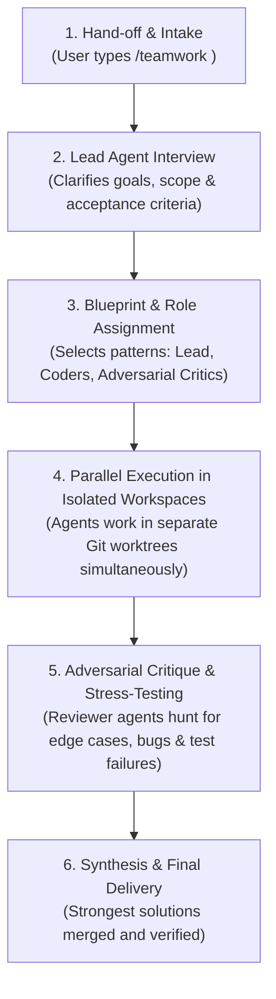

# Antigravity `/teamwork` Action Explained in Simple Words

---

## 👥 What is the `/teamwork` Action in Simple Terms?

Imagine you run a software company and need to build a major new system:
* **Single Agent Mode (Normal Chat):** You ask **one developer** to design the database, write the backend, build the frontend UI, write the tests, and review their own code. Because one person is juggling everything, they easily get overwhelmed, forget small details, and miss their own bugs.
* **`/teamwork` Action (Multi-Agent Team):** You hire a **complete agile software engineering team**:
  - A **Project Lead / Interviewer** who clarifies exactly what you need.
  - A **System Architect / Sentinel** who breaks the project into tasks and monitors progress.
  - **Specialized Developers** who work in parallel on backend, frontend, and database logic.
  - An **Independent Critic / Tester** whose only job is to aggressively test, challenge assumptions, and find flaws before anything is approved.

In Google Antigravity, **`/teamwork`** is a slash command that hands over your project to an **autonomous multi-agent system**. Multiple AI agents collaborate, review each other's work, and deliver large projects without running out of memory or hallucinating.

---

## ⚙️ How Does `/teamwork` Work Behind the Scenes?

When you type `/teamwork` in Antigravity, it triggers an advanced multi-step lifecycle:



### 1. Hand-off & Intake
* The primary assistant does not try to solve the entire problem in one breath.
* Instead, it invokes the specialized `teamwork` subagent cluster and hands over your goal and project context.

### 2. Scoping & Interview (The Lead Agent)
* Before touching code, the team lead or interviewer asks clarifying questions to understand edge cases, business rules, and tech stack choices.
* *(Tip: If you already wrote a detailed prompt and want to skip this phase, you can type `/teamwork [skip-interview] <your task>`.)*

### 3. Dynamic Blueprinting
* The framework picks an orchestration blueprint tailored for your task:
  - **Sentinel / Coordinator:** Tracks milestones, manages state, and prevents context overload.
  - **Implementers:** Write the code, APIs, and UI components.
  - **Validators / Critics:** Run automated checks, compile builds, and verify security.

### 4. Isolated Git Workspaces
* Each agent operates in its own isolated workspace or Git worktree.
* This prevents agents from accidentally overwriting each other's work or breaking the main branch.

### 5. Adversarial Review (No Blind Agreement)
* In simple AI chats, a single model tends to assume its own code is perfect.
* In `/teamwork`, **adversarial reviewer agents** actively try to break the code, test edge cases, and challenge logic before anything is merged.

### 6. Synthesis & Milestone Checkpoint
* The coordinator merges the best pieces together, runs full-project builds and tests, and presents the completed milestone to you for approval.

---

## 🎯 When and Where to Use `/teamwork`

### Where to Use It:
* **Antigravity Chat Canvas:** Type `/teamwork` followed by your project prompt in the main chat prompt bar.
* **Antigravity CLI (`agy`):** In the terminal UI, type `/teamwork` to launch autonomous background teams.

### When to Use It:

| Situation | Why `/teamwork` is Ideal | Real-World Example |
|---|---|---|
| **1. Large Full-Stack Projects** | Divides backend, frontend, database, and auth among dedicated agents. | Building an e-commerce platform like **FurniNest** (.NET backend + Angular frontend + SQLite + JWT auth) from scratch. |
| **2. Multi-File Refactoring** | Changing APIs or data models across 30+ files without losing consistency. | Migrating a legacy monolith from ASP.NET MVC to .NET Web API with modern DTOs and SignalR real-time hubs. |
| **3. Complex Research & Simulation** | Needs deep counter-example searching, algorithmic validation, or simulation engines. | Designing CPU emulators, game engines, or complex financial simulation models. |
| **4. Long-Horizon Tasks (Hours/Days)** | Single agents suffer from context drift after long conversations; teams pass clean summaries across milestones. | Conducting an end-to-end security hardening audit and implementing fixes across an entire repository. |
| **5. Cross-Layer Verification** | Dedicated testing agents verify contract matching between API endpoints and client components. | Verifying that Angular models match .NET C# DTOs with 0 type discrepancies and 100% build success. |

---

## ⚖️ Pros and Cons (Prons & Crons) of `/teamwork`

Here is an honest, balanced breakdown of benefits and drawbacks:

### 🟢 Pros (Advantages)

* **1. No Single Point of Failure (Adversarial Quality Control):**
  One agent writes the code, while a completely different agent critiques and stress-tests it. This catches subtle logic bugs, security holes, and missing edge cases.
* **2. Solves Context Window Bloat:**
  Single-agent chats get slower, forget earlier instructions, or hallucinate after many turns. `/teamwork` splits tasks across subagents, keeping each agent's context clean and sharp.
* **3. True Parallel Work:**
  A backend agent can write C# controllers while a frontend agent builds Angular components at the same time in isolated worktrees.
* **4. Clean Git Safety:**
  Work is conducted in temporary Git branches/worktrees, ensuring your main working code is never left in a broken, half-finished state.
* **5. Hands-Off Autonomous Execution:**
  You can set a broad objective, step away, and let the team execute multi-phase planning, implementation, and test verification autonomously.

---

### 🔴 Cons (Disadvantages & Trade-offs)

* **1. High Token & Resource Consumption:**
  Running multiple AI models (coordinators, coders, testers) in parallel uses significantly more API quota, credits, and compute than a single prompt.
* **2. Slower Turnaround for Small Tasks:**
  Because it plans, delegates, interviews, and critiques, simple tasks take minutes instead of seconds.
* **3. Overkill for Trivial Changes:**
  If you only need to fix a typo, change a CSS color, or write a single utility function, `/teamwork` adds unnecessary coordination overhead.
* **4. Can Require Upfront Clarification:**
  Unless you pass `[skip-interview]`, the team will pause to ask you multiple questions before starting work.
* **5. May Need Conflict Resolution:**
  Occasionally, implementation agents and critic agents may debate trade-offs, requiring human confirmation or additional rounds of synthesis.

---

## 🚦 Quick Decision Guide: Normal Mode vs. Boost vs. Teamwork

```
What is the size and complexity of your task?
│
├── 🔹 Small & Quick (Typo fix, 1 function, CSS styling, simple question)
│      └── 👉 Use NORMAL CHAT (Instant, low tokens)
│
├── 🚀 Medium to Large Feature (New controller, component, bug fix, architectural planning)
│      └── 👉 Use /boost or /plan (Single agent, deep reasoning, phased execution)
│
└── 👥 Massive / Long-Horizon Project (Full-stack apps, multi-file refactoring, autonomous multi-day tasks)
       └── 👉 Use /teamwork (Multi-agent team: Lead + Implementers + Adversarial Critics)
```

---

## 💡 How to Use `/teamwork` in Practice

### Syntax:
```bash
# Standard usage (starts an intake interview first):
/teamwork Build a full-stack real-time chat application with .NET SignalR and Angular

# Fast-track usage (skips the interview and starts immediate execution):
/teamwork [skip-interview] Refactor all repository classes to use EF Core async methods across backend/
```

### Pro-Tips:
1. **Be specific with acceptance criteria:** The team performs best when given measurable goals (e.g., "Must pass all unit tests and `dotnet build` with 0 warnings").
2. **Use `[skip-interview]` when your prompt is exhaustive:** If you have already written detailed specifications, add `[skip-interview]` at the beginning to save time.
3. **Check in anytime:** You can ask the lead agent for a progress report at any point during execution.

